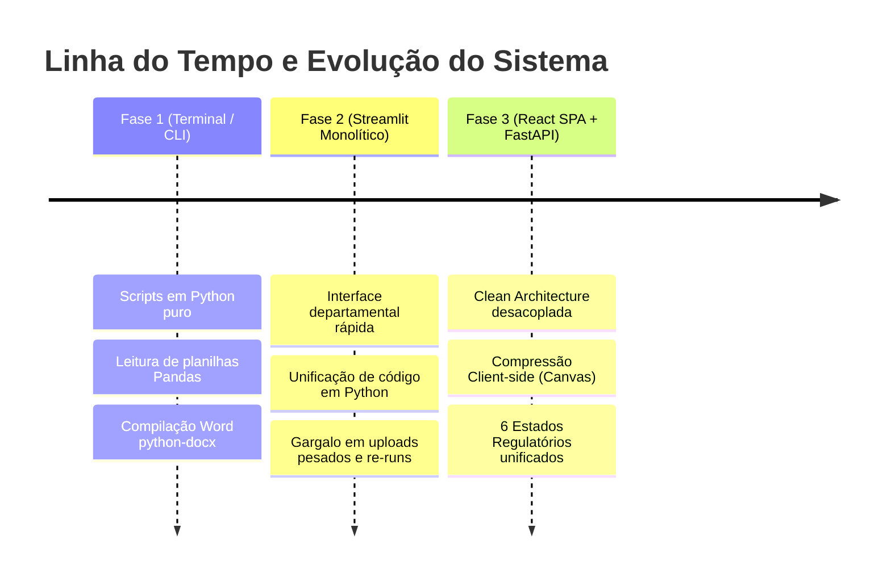

# Arquitetura e Engenharia de Software — Gerador de Relatórios ARPE

Documento técnico canônico de referência arquitetural, padrões de projeto, bibliotecas e diretrizes de engenharia de software do projeto **Gerador de Relatórios**.

---

## 🏛️ 1. Trajetória e Evolução Arquitetural

A arquitetura do sistema foi lapidada através de três fases evolutivas para suportar a complexidade regulatória dos contratos da ARPE:



1. **Terminal / CLI (Fase Inicial):**
   - Ferramenta interna em script de linha de comando para automação de tarefas repetitivas de formatação no Word.
2. **Streamlit (Fase Intermediária):**
   - Criação da primeira interface gráfica em Python para os analistas sem necessidade de API separada.
   - *Motivo da substituição:* Com o aumento no volume de fotos (centenas de imagens por vistoria) e a complexidade das regras de monitoramento, o ciclo de re-runs do Streamlit gerava lentidão, perda transitória de estados e rigidez visual.
3. **React + FastAPI (Arquitetura Atual):**
   - Separação completa de responsabilidades. O frontend atua como uma SPA moderna e responsiva, enquanto o backend FastAPI atua exclusivamente no processamento de dados, extração de documentos anteriores e geração tipográfica dos arquivos `.docx`.

---

## 📦 2. Stack Tecnológica e Bibliotecas Utilizadas

### 2.1. Frontend (SPA)
| Tecnologia / Biblioteca | Versão / Tipo | Função e Justificativa no Projeto |
| :--- | :--- | :--- |
| **React** | `^18.x` | Construção declarativa da interface, componentes e modais interativos. |
| **Vite** | `^6.x` | Build tool ultrarrápido com Hot Module Replacement (HMR) e empacotamento otimizado. |
| **TypeScript** | `^5.x` | Tipagem estrita de contratos de domínio, payloads da API e prevenção de erros em tempo de desenvolvimento. |
| **Tailwind CSS** | `^3.x` | Estilização utilitária de alto desempenho e design corporativo padronizado. |
| **Zustand** | `^5.x` | Gerenciamento de estado global leve e reativo (fiscalizações ativas, lista de achados, fotos vinculadas). |
| **HTML5 Canvas API** | Nativa | Compressão client-side de imagens de alta resolução (redução de fotos de 8 MB para ~80 KB). |
| **File System Access API** | Nativa | Seleção de diretórios locais completos com centenas de fotos de campo em um clique. |
| **IndexedDB** | Nativo | Cache e persistência local offline de vistorias em andamento. |
| **Lucide React** | `^0.4x` | Iconografia moderna e semântica para ações de sistema. |

### 2.2. Backend (API & Engine de Relatórios)
| Biblioteca Python | Versão / Tipo | Função e Justificativa no Projeto |
| :--- | :--- | :--- |
| **Python** | `3.10+` | Linguagem base do motor de dados e processamento de documentos. |
| **FastAPI** | `^0.115` | Framework assíncrono de alta performance para exposição de endpoints REST. |
| **Uvicorn** | `^0.34` | Servidor ASGI leve para execução e hot-reload local. |
| **Pydantic** | `^2.x` | Validação estrita de schemas de entrada/saída e tipagem de payloads. |
| **python-docx** | `^1.1` | Manipulação nativa de documentos Word (.docx), montagem de tabelas, quebras de página e estilos XML. |
| **Pillow (PIL)** | `^11.x` | Processamento de imagens, correção de orientação de celular (`exif_transpose`) e extração de metadados EXIF (`DateTimeOriginal`). |
| **Pandas** | `^2.2` | Processamento, ordenação e limpeza de dados tabulares de fiscalização. |
| **OpenPyXL** | `^3.1` | Leitura e geração de planilhas Excel estruturadas para auditoria de dados. |
| **Pytest** | `^9.1` | Suíte de testes automatizados unitários, de regressão e de integração BDD/TDD. |

---

## ⚖️ 3. Técnicas de Arquitetura e Princípios de Engenharia

### 3.1. Clean Architecture (Arquitetura Limpa)
O fluxo de dependência aponta estritamente para dentro:
- **`src/core/` (Domínio Puro):** Regras regulatórias das concessionárias e entidades congeladas (`@dataclass(frozen=True)`). Não possui nenhuma dependência de frameworks web, `docx` ou `openpyxl`.
- **`src/reports/` (Camada de Apresentação de Documentos):** Classes especializadas de relatórios estruturadas sob herança de `BaseReport`.
- **`src/services/` (Serviços e Infraestrutura):** Processamento de imagens, persistência de metadados, leitura de planilhas e extração de documentos anteriores.
- **`src/server/` (Camada de Entrega HTTP):** Controllers FastAPI e schemas Pydantic de transporte de dados.

### 3.2. Princípios SOLID Aplicados
- **S (Single Responsibility):** O servidor HTTP apenas transporta dados; a lógica de negócio reside em `src/core/rules/`; a montagem visual das tabelas Word reside em `src/sections/`.
- **O (Open/Closed):** Para adicionar uma nova concessionária ou modalidade, implementa-se uma nova classe derivada de `BaseReport` registrada em `src/reports/factory.py`, sem alterar a lógica das classes existentes.
- **L (Liskov Substitution):** Qualquer classe de relatório pode substituir transparentemente `BaseReport` satisfazendo os contratos `IReportContract`.
- **I (Interface Segregation):** Contratos segregados em `src/core/interfaces/` orientados a responsabilidades pontuais (`ICapaConfig`, `ISumarioConfig`, `IQuadroConfig`, etc.).
- **D (Dependency Inversion):** O motor de compilação depende de abstrações de configuração e interfaces de domínio, não de instâncias concretas acopladas.

### 3.3. Princípio DRY (*Don't Repeat Yourself*)
- Algoritmos de ordenação natural humana de fotos, geração sequencial de códigos anuais (`/{ano}.001`, `/{ano}.002`, `/{ano}.003`) e padronização de tabelas com largura útil A4 (7.27 polegadas) são compartilhados por módulos transversais, eliminando código duplicado.

### 3.4. BDD (Behavior-Driven Development) & TDD
- Regras de negócio possuem testes automatizados formalizados sob a sintaxe *Given / When / Then*:
  - Garantia de concordância gramatical feminina na CRC ("1 (uma) não conformidade").
  - Sequenciamento atômico de códigos na CRA e na SOCICAM.
  - Validação estrita de documentos anteriores no fluxo de Monitoramento.

### 3.5. Conformidade com a LGPD (Lei nº 13.709/2018)
- **Soberania e Privacidade Local:** Todo o processamento pode ser executado integralmente em ambiente local sem transmissão de fotos para servidores externos.
- **Minimização de Dados Pessoais:** O cadastro de responsáveis armazena apenas dados estritamente necessários para a fé pública do relatório (Nome, Cargo/Matrícula), bloqueando o armazenamento de dados sensíveis.

---

## 🚦 4. Os 6 Estados Regulatórios do Domínio

O sistema gerencia de forma unificada e sem colisão as **6 combinações de relatório** originadas das 3 concessões reguladas pela ARPE e das 2 modalidades de inspeção:

```
                  ┌─────────────── Contratos Regulados ───────────────┐
                  │                                                   │
                [CRA]                               [CRC]          [SOCICAM]
        (Rota do Atlântico)                 (Rota dos Coqueiros)   (Terminais TIP/Caruaru/...)
          /              \                     /            \         /              \
    [Fiscalização]  [Monitoramento]    [Fiscalização] [Monitoramento] [Fiscalização] [Monitoramento]
```

1. **CRA Fiscalização:** Vias expressas de acesso a Suape. Controle de Pista, Faixa, Trecho/KM e codificação `CRA.ST{subtrecho}.{estaca_ini}-{estaca_fim}/{ano}.{seq:03d}`. Distinção entre Não Conformidades (NC) e Pontos de Atenção (PA).
2. **CRA Monitoramento:** Auditoria de resolutividade em relação a vistorias e ofícios anteriores do Convênio SUAPE/ARPE nº 003/2021.
3. **CRC Fiscalização:** Rodovia PE-024 e Ponte do Paiva (PPP CGPE-001/2006). Exigência mandatória de redação das conclusões em numerais gramaticais femininos por extenso ("1 (uma)", "2 (duas)").
4. **CRC Monitoramento:** Comparação direta contra o relatório anterior (`.docx`) com extração dinâmica de variáveis SEI, número da vistoria ($N-1 \rightarrow N_{curr}$) e construção do Quadro de Situação das pendências.
5. **SOCICAM Fiscalização:** Terminais Rodoviários Intermunicipais (TIP Recife, Caruaru, Garanhuns, Petrolina - Concessão Nº 1.041.080/08). Interface adaptada para setores prediais (sem faixas rodoviárias), normalização de nomes de terminais e codificação sequencial `{codificação}/{ano}.{seq:03d}`.
6. **SOCICAM Monitoramento:** Acompanhamento do saneamento de irregularidades nos terminais rodoviários com geração do Quadro de Determinações.

