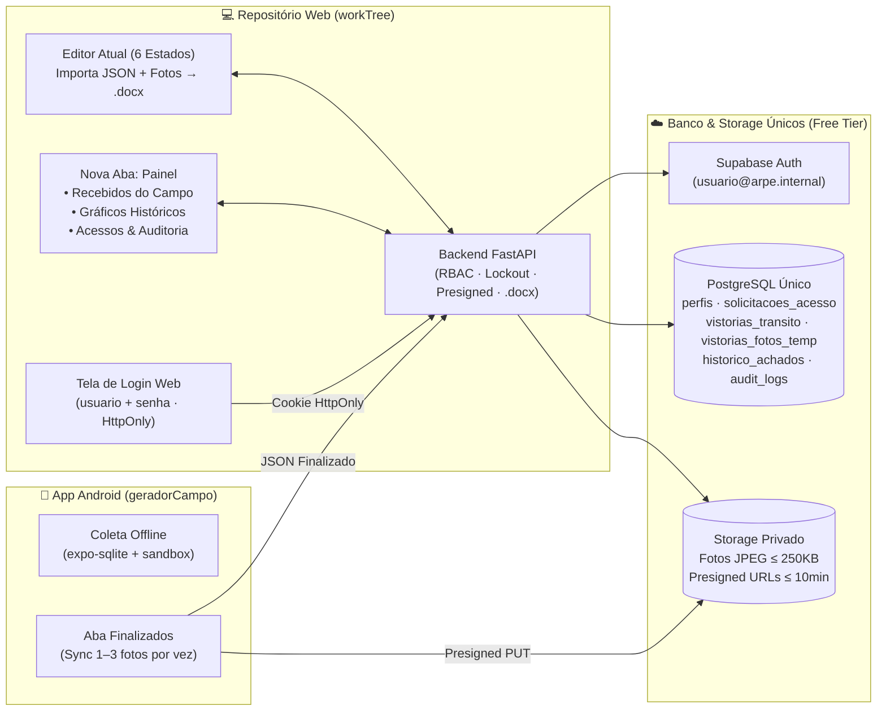

# Arquitetura Web + Backend FastAPI — Login (RBAC), Aba de Painel e Integração com o App `geradorCampo`

> **Autoria:** Tech Lead Analyst · Repositório Web (`workTree`) — **Gerador de Relatórios ARPE**
> **Alinhamento Contratual:** Espelha 100% o schema SQL (`001_init_arpe.sql`) e os contratos de segurança definidos no aplicativo Android parceiro (`geradorCampo`).
> **Premissas:** **1 único banco PostgreSQL** (Supabase Free 500 MB) + **1 Object Storage Privado** (Cloudflare R2 10 GB Free ou Supabase Storage Privado), sistema fechado (até 10 usuários), **login sem e-mail** (`usuario + senha`), 3 perfis RBAC (`adm`, `coordenador`, `analista`), 6 estados regulatórios (`CRA`, `CRC`, `SOCICAM` × `Fiscalização`, `Monitoramento`), OWASP Top 10 Web e LGPD (Lei nº 13.709/2018).

---

## 1. Visão Geral da Integração (`geradorCampo` APK ↔ Web + FastAPI)

O **App Android (`geradorCampo`)** coleta vistorias e fotos offline em campo e envia as sessões finalizadas para o banco/storage único. O **Sistema Web (`workTree`)** atua como a central de **autenticação, governança, revisão em painel, emissão oficial do `.docx` e inteligência histórica**.

---

## 2. Banco de Dados Único (Contrato Compartilhado com `001_init_arpe.sql`)

O repositório Web **consome exatamente as mesmas 6 tabelas** já modeladas em `geradorCampo/supabase/migrations/001_init_arpe.sql` (com **RLS habilitado em 100% delas**):

| Tabela | Papel no Sistema Web | Quem Acessa no Web |
| :--- | :--- | :--- |
| **`perfis`** | Dados do usuário logado (`usuario`, `nome_completo`, `role`, `ativo`, `tentativas_falhas`, `bloqueado_ate`) | Próprio perfil (todos); gestão completa (`adm`) |
| **`solicitacoes_acesso`** | Fila de novos pedidos de conta (`analista` ou `coordenador`; `adm` bloqueado por `CHECK` SQL) | `adm` e `coordenador` (aprovação individual) |
| **`vistorias_transito`** | Vistorias enviadas pelo APK (`status_handoff`: `aguardando_web` → `em_revisao` → `emitida`) + `payload_json` | `analista` (próprias); `coordenador` e `adm` (todas) |
| **`vistorias_fotos_temp`** | Metadados e `storage_key` privado das fotos JPEG (≤ 500 KB) — **zero binário no PostgreSQL** | Segue permissão da vistoria pai via Presigned GET |
| **`historico_achados`** | Histórico permanente **sem fotos e sem PII** (apenas NCs/PAs agregáveis para gráficos de meses/anos) | Leitura para todos os autenticados; escrita pelo FastAPI após emissão |
| **`audit_logs`** | Trilha *append-only* de logins, lockouts, aprovações, desativações e expurgos | Leitura exclusiva do `adm` |

---

## 3. Fluxo de Autenticação Web (`Login` sem E-mail & RBAC)

### 3.1. Tela de Login Web (`LoginPage.tsx`)
* **Identidade ARPE:** Visual institucional (`#071d36`, superfícies brancas limpas, zero cara genérica de IA).
* **Campos:** Apenas **`Usuário`** (ex.: `pedro.souza`, `ctr01`) + **`Senha`** — **nenhum campo de e-mail**.
* **Mapeamento Transparente no Backend:** O FastAPI converte `usuario` → `${usuario.toLowerCase()}@arpe.internal` para autenticar no Supabase Auth sem expor nem disparar e-mails.
* **Sessão Segura no Navegador (Anti-XSS / Anti-CSRF):**
  * **PROIBIDO** salvar JWT em `localStorage` ou `sessionStorage`.
  * O FastAPI emite cookies **`HttpOnly; Secure; SameSite=Strict`** (Access Token 15 min + Refresh Token rotativo) e valida `Origin`/`Referer` contra `ALLOWED_ORIGINS`.
* **Solicitar Acesso:** Modal discreto **"Solicitar Acesso"** permitindo informar `nome_completo`, `usuario`, `perfil` (`Analista` ou `Coordenador` — **nunca `ADM`**) e senha forte (≥ 10 chars). A conta só fica ativa após aprovação de um `ADM` ou `Coordenador`.
* **Anti-Brute-Force:** 5 tentativas falhas bloqueiam a conta por **15 minutos** (`bloqueado_ate`) + *rate limit* por IP + registro em `audit_logs`.

### 3.2. Matriz de Permissões (`RBAC`) no Web

| Funcionalidade no Web | `analista` | `coordenador` | `adm` |
| :--- | :---: | :---: | :---: |
| Acessar Editor de Relatórios (6 Estados) e gerar `.docx` | ✅ | ✅ | ✅ |
| Aba **Painel → Recebidos do Campo** | ✅ *(próprias)* | ✅ *(todas)* | ✅ *(todas)* |
| Importar vistoria do campo para o Editor + confirmar expurgo pós-`.docx` | ✅ *(próprias)* | ✅ *(todas)* | ✅ *(todas)* |
| Aba **Painel → Gráficos Históricos** (`historico_achados`) | ✅ | ✅ | ✅ |
| Aba **Painel → Aprovação de Acessos** (`solicitacoes_acesso`) | ❌ | ✅ | ✅ *(reconfirma senha)* |
| Aba **Painel → Usuários, Desbloqueio, `audit_logs` e Limpeza em Lote** | ❌ | ❌ | ✅ *(reconfirma senha)* |

---

## 4. Nova Arquitetura da Interface Web: Navegação com Aba `Painel`

Para integrar o banco de dados sem quebrar a experiência atual do Editor de Relatórios (Etapas `01 → 04/05`), a `Sidebar` e o `TopHeader` do Web passam a oferecer **2 modos de trabalho principais** (além do botão de sair/perfil):

1. **Aba `Painel` (Nova Central de Campo & Governança):**
   * **Sub-aba 1 — Recebidos do Campo (`vistorias_transito`):**
     * Filtros por Concessão (`CRA`, `CRC`, `SOCICAM`), Modalidade (`Fiscalização`, `Monitoramento`) e Status (`Aguardando Web`, `Em Revisão`, `Emitida`).
     * Cards/Tabela limpa exibindo: `ID da Fiscalização`, Concessão/Modalidade (badge na cor oficial de `concessionTheme.ts`), Local/Terminal, Autor, Data, contagem de NCs/PAs e quantidade de fotos sincronizadas.
     * **Ação Principal — "Abrir no Editor":**
       1. Chama `GET /api/sync/vistorias/{id}` e `GET /api/sync/vistorias/{id}/fotos-urls` (Presigned GET URLs com validade ≤ 10 min).
       2. Baixa as fotos e hidrata automaticamente o `useReportStore` na modalidade exata (`CRA`/`CRC`/`SOCICAM` × `Fiscalização`/`Monitoramento`), alternando para a aba **Editor** com tudo pronto para revisão e emissão do `.docx`.
       3. Atualiza `status_handoff` para `em_revisao`.
     * **Ação Pós-Emissão — "Concluir & Limpar Fotos Temporárias":**
       * Após o analista baixar o `.docx`, grava os achados estruturados (sem fotos e sem PII) em `historico_achados`, marca `status_handoff = 'emitida'` e remove os binários temporários de `vistorias_fotos_temp` + Storage Privado.
   * **Sub-aba 2 — Gráficos Históricos (`historico_achados`):**
     * Filtros por Período (mês/ano), Concessão e Modalidade.
     * Gráficos leves (SVG/Tailwind harmonizados com o tema ARPE): evolução mensal de NCs/PAs, taxa de saneamento por concessão e Top 5 categorias de Não Conformidades recorrentes.
   * **Sub-aba 3 — Gestão & Acessos (Visível apenas para `coordenador` e `adm`):**
     * Fila de `solicitacoes_acesso` com botões **Aprovar** / **Rejeitar** (exigindo reconfirmação de senha quando o ator for `adm`).
     * Bloco exclusivo `adm`: tabela de `perfis` (ativar/desativar, remover bloqueio de 15 min) e visualizador *read-only* de `audit_logs`.
2. **Aba `Editor de Relatórios` (Fluxo Atual Preservado 100%):**
   * Mantém intactos os 6 estados, `FiscalizacaoForm`, `UploadPanel`, `RegistroNcForm`, `RecomendacaoGeralPanel` (Etapa 04 em `SOCICAM Monitoramento`), `SummaryAndActionsPanel` (Etapa 04/05) e a persistência local opcional `geradorBD`.

---

## 5. Arquitetura Backend FastAPI (SRP — Sem Inchar `main.py`)

Para respeitar o **Princípio da Responsabilidade Única (SRP)**, a camada HTTP em `backend/src/server/main.py` **NÃO** deve receber lógica de banco ou autenticação diretamente. Criar módulos dedicados:

* `backend/src/services/supabase_client.py` — cliente único configurado via variáveis de ambiente (`SUPABASE_URL`, `SUPABASE_SERVICE_ROLE_KEY`) e cliente R2/Storage para Presigned URLs.
* `backend/src/services/auth_service.py` — regras de conversão `usuario → @arpe.internal`, validação de força de senha, lockout (5 erros / 15 min), hash Argon2id/bcrypt temporário, aprovação individual e escrita em `audit_logs`.
* `backend/src/services/sync_service.py` — validação de *magic bytes* JPEG (`FF D8 FF`), emissão de Presigned PUT/GET URLs (≤ 10 min), *upsert* de `vistorias_transito`, expurgo de fotos pós-emissão e gravação idempotente em `historico_achados`.
* `backend/src/server/dependencies/auth_deps.py` — middlewares/dependências FastAPI `get_current_user` (aceita Bearer JWT do APK ou Cookie `HttpOnly` do Web) e `require_roles("adm", "coordenador")`.
* `backend/src/server/routers/`:
  * `auth_router.py` (`/api/auth/login`, `/api/auth/logout`, `/api/auth/me`, `/api/auth/refresh`, `/api/auth/solicitar-acesso`, `/api/auth/solicitacoes`, `/api/auth/solicitacoes/{id}/decidir`, `/api/auth/usuarios`, `/api/auth/audit-logs`)
  * `sync_router.py` (`/api/sync/presign-upload`, `/api/sync/vistorias`, `/api/sync/vistorias/{id}`, `/api/sync/vistorias/{id}/fotos-urls`, `/api/sync/vistorias/{id}/concluir`)
  * `historico_router.py` (`/api/historico/resumo`, `/api/historico/series`)

---

## 6. Segurança OWASP Top 10 & LGPD no Web (Bloqueantes)

1. **Fechar CORS (`Code Smell #9`):** Substituir `allow_origins=["*"]` em `backend/src/server/main.py` por lista fechada `ALLOWED_ORIGINS` (ex.: domínio Vercel de produção + `http://localhost:5173` em dev) mantendo `allow_credentials=True` para cookies `HttpOnly`.
2. **Cabeçalhos de Segurança HTTP:** Middleware no FastAPI adicionando `X-Content-Type-Options: nosniff`, `X-Frame-Options: DENY`, `Referrer-Policy: no-referrer` e `Content-Security-Policy`.
3. **Zero Segredos no Frontend:** `frontend/.env` nunca recebe `SUPABASE_SERVICE_ROLE_KEY`, chaves R2 ou segredos de assinatura. Toda operação privilegiada passa pelo FastAPI autenticado.
4. **Logs Sanitizados (LGPD):** Nunca logar senhas, tokens, cookies, Presigned URLs ou payloads completos com nomes/observações.
5. **Expurgo & Minimização:** Fotos temporárias existem no Storage apenas até a emissão confirmada do `.docx` no Web; `historico_achados` nunca armazena imagens nem dados pessoais de terceiros.
